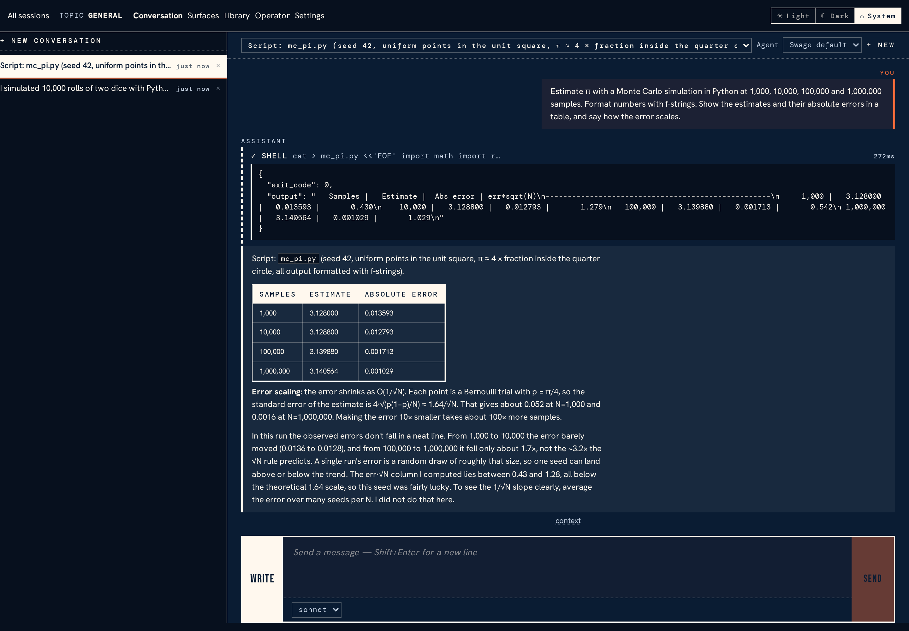
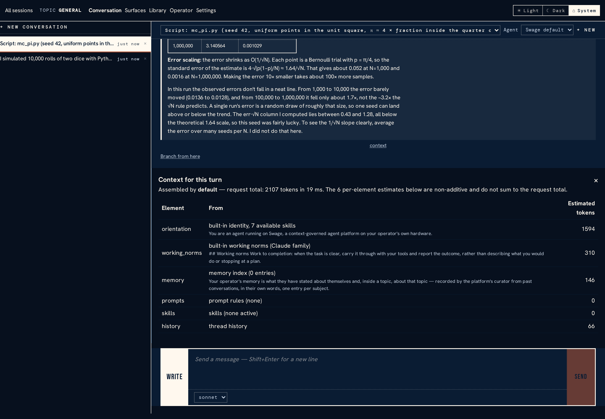
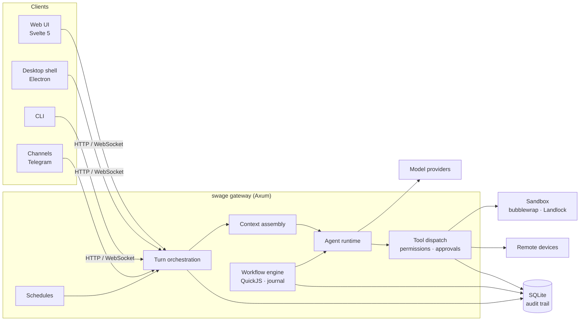

# Swage

**A self-hosted platform for running AI agents you can see inside.**

Swage is an always-on gateway that runs agents on your own hardware — in
conversation, on a schedule, or as scripted multi-agent workflows — and
records everything they do in one local audit trail. Every turn's context is
assembled deliberately and kept, so you can open any reply afterwards and see
exactly what the model was shown, which tools it called, what it was allowed
to do, and why.

It is written in Rust (gateway, agent runtime, workflow engine, sandbox) with
a Svelte 5 web UI and an Electron desktop shell.



> [!WARNING]
> **Swage is very early alpha.** It is used daily by its author, but it is not
> ready for anyone else to depend on:
>
> - **No compatibility promises.** Storage formats, configuration and APIs
>   change without migrations or deprecation periods; an upgrade may mean
>   starting from a fresh data directory.
> - **Single operator, Linux only.** One person's gateway on their own
>   machine, by design. Sandboxing relies on Linux (bubblewrap, Landlock).
> - **No authentication.** Run it on loopback or a network you fully trust.
> - **No licence chosen yet.** See [Licence](#licence) below.

## Why Swage

Most agent tools are either a chat window over an API or a framework you
assemble yourself. Swage is a long-running service with opinions about three
things those tend to leave out:

- **Context is governed, not accumulated.** Each turn's context — orientation,
  operator instructions, `AGENTS.md` guidance, skills, memory, history — is
  composed by a named assembly that records what it included, what it left
  out, and why. The web UI's turn inspector shows that record for any reply.
  Assemblies are swappable, and can be scripted in JavaScript.
- **Everything is reconstructable.** Turns, tool calls, approvals, assembly
  decisions, configuration changes and workflow journals all land in one
  local SQLite store, and the record never leaves the machine. Network
  traffic is what you enable: model providers, plus tools and channels such
  as URL fetch, web search and Telegram.
- **Built for experiments.** Behaviour can be expressed as variants selected
  per session behind a stable surface — today, context assembly, the working
  norms a model is given, task prompts and the memory curator's prompt — so
  two ways of doing something can be compared on real work. Neither the user nor
  the model sees which variant is running, every selection is recorded, and
  experimentation can be switched off globally or per location for new
  sessions.

<p align="center">
  
  <br><em>Every reply links to the context it was built from.</em>
</p>

## What it does today

| Area | What's there |
|---|---|
| **Providers** | Anthropic, OpenAI Chat Completions and Responses, Google, and OpenRouter; retries, circuit breaking and failover between routes; per-model reasoning effort |
| **Tools** | File read/write/edit/search, shell, URL fetch, web search¹, a Chromium browser¹, Python execution¹, memory, a knowledge base with citations, schedules, workflows, and agent-built *surfaces* |
| **Safety** | Per-tool permissions with interactive approvals, grants that narrow as work is delegated, per-turn bubblewrap + Landlock sandboxing, and credential leak detection with redaction |
| **Workflows** | A JavaScript workflow engine (QuickJS) whose runs are journalled: a run interrupted by a crash or restart replays and carries on. Token budgets per provider route, durable parking on long timers, and runs that pause for a human decision |
| **Automation** | Schedules that start or continue sessions, external channels (Telegram¹), delivery targets, and remote *devices* that dial in and execute tools on other machines |
| **Context** | Scriptable context assembly, compaction, and recovery for sessions that keep failing: separate readers diagnose what went wrong and the session continues from their notes |
| **Interfaces** | Web UI, desktop shell and CLI; a wire contract defined once in Rust and projected to TypeScript, JSON Schema and OpenAPI |

¹ Needs something outside Swage; see [Optional capabilities](#optional-capabilities).

## Quick start

Swage targets Linux. You need the Rust toolchain (pinned by
`rust-toolchain.toml`), Node 24, and
[bubblewrap](https://github.com/containers/bubblewrap), which the per-turn
sandbox runs on.

```bash
git clone https://github.com/BFJ-Concerns/Swage.git && cd Swage
cargo build --bin swage
```

No turn can complete until a model provider is configured, and the gateway
reads its configuration when it starts, so write `~/.swage/config.toml`
first:

```toml
[providers]
default = "anthropic"

[providers.entries.anthropic]
protocol = "anthropic"                # or "openai", "openai-responses", "google", "openrouter"
api_key_env = "ANTHROPIC_API_KEY"     # read from the gateway's environment
# base_url = "https://..."            # only for proxies or self-hosted routes

[models]
default = "sonnet"

[models.entries.sonnet]
provider_id = "anthropic"
model_id = "claude-sonnet-5"
default_effort = "high"               # optional: off|minimal|low|medium|high|xhigh|max
```

Then start the gateway with the key in its environment, and the web UI
beside it:

```bash
export ANTHROPIC_API_KEY=...
./target/debug/swage gateway start          # listens on 127.0.0.1:3000

# In another terminal: the web UI on http://localhost:5173
cd frontend && npm install && npm run dev
```

If you edit `config.toml` by hand later, stop and start the gateway again.

Providers and models can also be managed from the web UI under
**Settings → Providers**. Then open the UI, start a session, and see
[First session](docs/first-session.md) for topics, workspaces and trust.

To try Swage without touching a real installation, point `SWAGE_HOME` at a
throwaway directory: `SWAGE_HOME=/tmp/swage-try ./target/debug/swage gateway start`.

## How it fits together



The Cargo workspace is split by responsibility:

| Crate | Responsibility |
|---|---|
| `swage` | The CLI binary: gateway lifecycle, shell completion |
| `swage-gateway` | HTTP and WebSocket server, turns, tools, schedules, channels, workflow host |
| `swage-agent` | Streaming agent loop, tool dispatch, structured-output retries, delegation |
| `swage-context` | Context assembly, orientation, working norms, JavaScript assemblies |
| `swage-provider` | Provider adapters with retry, circuit breaking and failover |
| `swage-codex` | Transport for the Codex app server |
| `swage-workflow` | Deterministic JavaScript orchestration and replay |
| `swage-tool` | Tool trait, registry and schema validation |
| `swage-sandbox` | bubblewrap and Landlock isolation for tool execution |
| `swage-safety` | Credential leak detection and redaction |
| `swage-storage` | SQLite persistence: the audit trail and everything else |
| `swage-config` | Configuration cascade, validation and skills |
| `swage-protocol` | The wire contract, projected to TypeScript, JSON Schema and OpenAPI |
| `swage-client` / `swage-device` | Rust client, and the remote device runtime |
| `swage-python` | Child-process Python workers |
| `swage-core` / `swage-hook` | Shared types and lifecycle hooks |

[docs/architecture-flow.svg](docs/architecture-flow.svg) draws a turn's full
route through these pieces.

## Documentation

- [First session](docs/first-session.md) — topics, attaching a repository as
  a workspace, and trusting it.
- [Agents and permissions](docs/agents-and-permissions.md) — agent
  definitions, `AGENTS.md` guidance, effort, tool permissions, approvals,
  sandboxing and experimentation controls.
- [Workflow engine](docs/workflow-engine.md) — how scripts run, replay after a
  restart, spend their budgets, park, and account for how they ended.
- [Interfaces and tooling](docs/interfaces-and-tooling.md) — the turn
  inspector, branching, surfaces, devices, credentials, the API error
  contract, and the wire-contract architecture.

## Running a gateway

### Lifecycle

The gateway detaches by default and writes its log to `gateway.log` in its
data root (`~/.swage/`, or `$SWAGE_HOME` when set). Use `--log-file PATH` for
another destination, or `--foreground` to keep it attached:

```bash
./target/debug/swage gateway start --foreground
./target/debug/swage gateway stop
```

The CLI finds the running gateway through a metadata file: under
`$SWAGE_HOME/run/` when `SWAGE_HOME` is set, otherwise under
`$XDG_RUNTIME_DIR/swage/`, falling back to `~/.swage/run/`. Run `stop` with
the same environment you started with. When
the gateway is the main process of a systemd service, `gateway restart`
restarts that service and waits for the new process to answer its health
endpoint. `swage generate-completion bash` (or `zsh`/`fish`) prints a shell
completion script.

### Credentials

`api_key_env` reads an environment variable at startup. The governed
alternative is `api_key_secret_ref`, which resolves through the gateway's
secret manager — every access is audited and the resolved value is redacted
from logs. Secrets can be `managed` (encrypted in the gateway's store), `env`,
or `file` (re-read on every access, optionally narrowed into a JSON document
by pointer, so externally refreshed tokens stay current). See
[Provider credentials](docs/interfaces-and-tooling.md#provider-credentials).

### Sandboxing and approvals

Per-turn sandboxing is on by default: sandbox-eligible tool calls run under
bubblewrap and Landlock. Tools that need live gateway state run in the gateway
process, and sessions targeting a remote device use that device's execution
path. If sandbox setup fails — most often because bubblewrap is not
installed — a turn you started yourself pauses to ask whether to continue
unsandboxed; a scheduled or delegated turn, with nobody to ask, fails. The
failure reason quotes the cause. `sandbox.allow_degraded_execution = true`
skips that approval.

To run a topic without the sandbox, set this in its `config.toml`; its turns
then record a degraded execution boundary so the audit trail says they ran
unconfined:

```toml
[sandbox]
enabled = false
```

Tools that act outside the conversation — `shell`, `file_edit`, `file_write`,
`python_execute` and the browser's click, type, select and scroll actions —
ask for your approval before each call in a session you are attending.
Scheduled, channel and delegated work runs on its grants alone.
[Agents and permissions](docs/agents-and-permissions.md#sandbox-isolation)
covers what the sandbox confines, how approvals work and how to change which
tools ask.

### Optional capabilities

These register or work only when their prerequisite is present:

| Capability | Prerequisite |
|---|---|
| Web search | A self-hosted [SearxNG](https://github.com/searxng/searxng) instance, configured under `[tools.search]` with `provider_type = "searxng"` and its `base_url` ([details](docs/agents-and-permissions.md#search-configuration)) |
| Browser tool | Chromium or Chrome on `PATH`, or its path in `SWAGE_BROWSER_BIN` |
| Python execution | `python3` on `PATH` |
| Telegram channel | A bot token from BotFather, named under `[channels.telegram]` as `bot_token_env = "<VARIABLE>"` |
| Voice | An OpenAI-protocol provider that serves the audio APIs (below) |

### Voice

Speech transcription and synthesis are optional. They need an
OpenAI-protocol default provider whose endpoint serves the audio APIs, plus a
model for each, set in `config.toml` or under **Settings → Voice**:

```toml
[voice]
transcription_model = "whisper-1"
speech_model = "tts-1"
```

### Where things live

Everything is under `~/.swage/` (or `$SWAGE_HOME`):

- `config.toml` — providers, models, sandboxing and platform settings.
- `AGENTS.md` and `instructions/*.md` — operator guidance read into every
  turn, layered after the built-in orientation. Workspaces may carry their own
  `AGENTS.md`.
- `skills/<name>/` — skills, one directory each.
- `topics/<topic>/` — a topic's own instructions, skills, per-agent overlays,
  memory and knowledge base.
- `general/` and `scratch/` — memory for sessions without a topic, and scratch
  directories for sessions without a workspace.
- `swage.db` — the SQLite store: conversations, turns, the audit trail, the
  knowledge base and workflow runs. The store refuses to open if its migration
  history does not match the build, rather than applying anything
  half-finished.

Configuration cascades Global → Topic → Agent; the more specific level
extends or shadows the more general one.

### Network binding

The gateway listens on `127.0.0.1:3000` by default. Set `[server] host` and
`port` in `config.toml`, or pass `--host`/`--port` to `gateway start`:

```bash
./target/debug/swage gateway start --host 192.0.2.10 --port 3000
```

**The gateway has no authentication.** Binding to a private-network address
trusts every host on that network with the full API and every configured
provider key. Public-internet exposure is not supported. Remember that the
host firewall must also allow the port before LAN clients can connect.

### A second, isolated instance

Give a development gateway its own data root and port, so it never opens
your real store or collides with the running instance; `SWAGE_HOME` also
gives it its own metadata file:

```bash
SWAGE_HOME=/tmp/swage-dev ./target/debug/swage gateway start --port 3100

# Point the dev web UI at it
SWAGE_GATEWAY_URL=http://127.0.0.1:3100 npm run dev
```

## Development

The repository's `just` recipes are the supported entry points:

| Command | What it runs |
|---|---|
| `just check` | Workspace and frontend type checks |
| `just check-gate` | The fast static gate: formatting, type checks, design-token checks, clippy |
| `just test` | Rust (nextest), frontend (Vitest) and desktop smoke tests |
| `just verify` | Everything above, plus a check that the generated protocol projections are current. CI runs exactly this |

Anything that crosses a process boundary is defined once in `swage-protocol`;
the TypeScript types under `frontend/src/lib/protocol/`, the JSON Schemas and
the OpenAPI document are generated from it. [AGENTS.md](AGENTS.md) holds the
repository's working conventions, for human and AI contributors alike.

API handlers fail with a `{"code","message"}` body whose codes are defined in
the protocol crate, and the client routes are described by an
OpenAPI 3.1 document at `crates/swage-protocol/schema/client-openapi.json`.

## Licence

No licence has been chosen yet. The source is published so it can be read,
and built and run for your own use; it grants no further rights. A licence
will follow. Until then, bug reports and questions are welcome as issues, but
pull requests can't be accepted.
